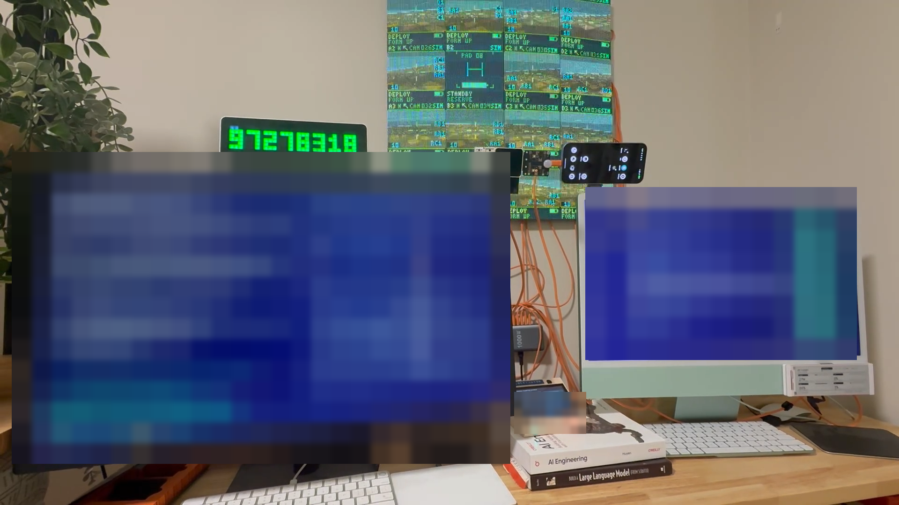

# Flockinator

**Meta Global AI Developer Hackathon 2026 · Indie Developer · Push the Frontier**

Flockinator is a physical lab for studying how small agents share information,
handle misleading reports and improve through measured experiments. Sixteen
ESP32-S3 nodes display a simulated search-and-rescue swarm, making each role
visible while Meta Muse models help build, review and refine the system.

**[Watch the narrated demo](https://www.youtube.com/watch?v=HaYNTBhXbu4)** ·
[Results and evidence](docs/results/README.md) ·
[Results dashboard](https://guruswami-ai.github.io/flockinator-public/results/)



## What is built

Each node has a 64×64 RGB panel, microphones, speaker output, environmental and
motion sensors, and SD storage. The Korvo controller hosts web controls, the
planner simulation and the learning lab. Panels render their scripted missions
locally and can store controller-generated journal copies. The LilyGo handheld
provides portable management. Execution locations and data flow are documented
in the [architecture](docs/architecture.md).

Sixteen Meta Muse assessor lanes review per-node evidence under a Wonder Full
coordinator. Candidate changes go through scoring, review and a controlled build
and deployment process. The [Meta evidence map](docs/meta-muse/README.md) records
model roles and the review workflow.

## What the evidence shows

The published planner simulations improved search coverage, but all four tested
candidates failed the full promotion criteria. Field observations record controller
connectivity failures and recovery behaviour. Acoustic communication has a tested
host model, with physical learning experiments proposed. The results directory
holds the [scorecard, provenance, limitations and reproduction steps](docs/results/README.md).

## Try the browser preview

```sh
uv run --project tools/node-commissioner python previews/recon-hud/serve.py
# Open http://127.0.0.1:8766/
```

This runs the scripted visual preview. See the [build guide](docs/build.md) for
firmware and host tools.

## Explore

| Topic | Guide |
|---|---|
| Swarms and shared intelligence | [Start here](docs/learn/README.md) |
| Experiment design and evidence | [Methodology](docs/experiments.md) |
| Rescue scenario and panel states | [Rescue scenarios](docs/scenarios/search-and-rescue/README.md), [illustrated state guide](docs/scenarios/quadcopter-survey/README.md) |
| Hardware and expansion | [Components](docs/hardware.md), [CAD models](cad/README.md) |
| Adversarial experiments | [Kulira](docs/kulira-friction.md), [attack taxonomy](docs/attack-taxonomy.md) |
| Sound, music and future experiments | [Acoustic model and goals](docs/learn/acoustic-language.md), [experiment catalogue](docs/experiment-catalogue.md), [Patternflow scenario](docs/scenarios/patternflow-flocking/README.md) |

This public repository contains firmware, tools, designs and synthetic experiment
fixtures. Real-node journals, recordings and credentials stay in private storage.
Public results identify their evidence source and execution location.

[Apache-2.0 licence](LICENSE) · [Contributing](CONTRIBUTING.md) ·
[Security](SECURITY.md). Third-party components retain their own licences.
