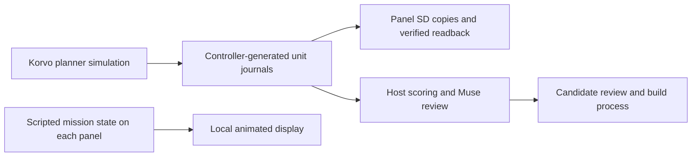

# Architecture

Flockinator is sixteen independent agent bodies, not one tiled display.
Each body senses, stores state, renders, and sounds locally; its brain
may run on the node, on an external host, or across both.

## System

Terms: a **node** (also panel/body/unit) is one ESP32 + 64x64 display;
a **lane** is the Muse assessor assigned to that node. Kulira is the
adversarial host. The Korvo is the standalone controller.

| Component | Role |
|---|---|
| 16x node (A1-D4) | ESP32-S3 body: 64x64 panel, sensors, audio, SD, health, OTA |
| Korvo controller | ESP32-S31 standalone host: fleet controls, planner, learning lab, archives |
| LilyGo handheld | Portable management remote and firmware-image store |
| External hosts | Inference, orchestration, analysis, and the Muse agent swarm |
| Kulira (adversary) | Bounded friction for robustness experiments; never a manager |

## Current execution and journal flow

The planner and communication-learning simulations run on the Korvo, with host
implementations used for replay and evaluation. Each panel independently renders
the scripted mission and exposes its hardware diagnostics. The controller creates
planner journals tagged `planner_simulation`, sends per-unit copies to panel SD
storage and verifies their hashes by readback. These copies record the controller's
simulated decisions. On-node learning requires evidence of execution on that node.
Source implementations are the [controller](../firmware/korvo-monitor/main/controller.cpp)
and [panel renderer](../firmware/node-platform/src/display.cpp).

## Traffic classes (always kept separate)

1. **Management** — identity, health, configuration, deployment, recovery.
   Authenticated (per-node HMAC-SHA256, challenge-response, replay
   protection). Nothing else may grant this authority.
2. **Observation / action** — node-to-brain streams with experiment
   latency budgets.
3. **Bulk / logs** — images, media, journal archives; scheduled so they
   cannot starve the other classes.
4. **Experimental peer traffic** — only the channels an experiment grants
   its agents. Director truth and management traffic stay out of agent
   inputs unless the experiment says otherwise.

Authentication answers *who sent a message*, never *whether its claim is
true*. Trust, corroboration, and exclusion are experiment outcomes, not
firmware privileges. A send acknowledgement is not delivery; a healthy
radio is not deployment readiness.

## Modules

| Module | Responsibility |
|---|---|
| `node-platform` | Node hardware, identity, lifecycle, display, sensors, audio, SD |
| `flock-network` | Discovery, messaging, connectivity, communication events (planned; commissioning subset in `firmware/shared/`) |
| `agent-runtime` | Local/remote/hybrid brains and body/brain bindings (planned) |
| `cluster-deployment` | Manifests, transport, activation, recovery (in `tools/` + firmware receivers) |
| `management-console` | Handheld and web management interfaces |
| `experiments` | Scenarios, observations, reproducible evaluation (in `tools/`, `previews/`, `docs/results/`) |
| `kulira-core` (+ disrupt/spoof/deceive/observe, bridge, e2e, rf-inventory) | Adversarial friction and its measurement |

Build order: `node-platform` -> `flock-network` -> `agent-runtime` and
`cluster-deployment` -> `experiments` and `management-console`.

## Invariants

- Panel brightness: 25% default, 50% hard ceiling, everywhere.
- Deterministic seeds; the seed (episode) is the replication unit -
  agents in one run are correlated, not independent samples.
- Experiments continue if a remote or browser disconnects; management
  and recovery stay available throughout.
- Private node data (identities, keys, real-node journals) never enters
  this public repository.
