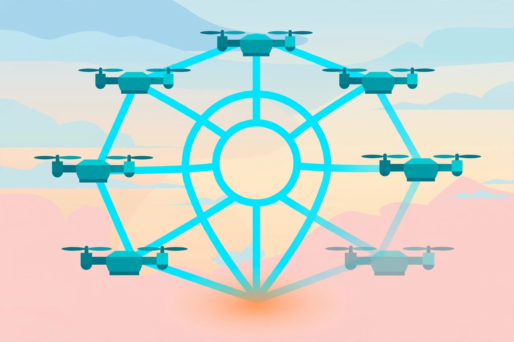

# Intelligence between nodes

*Illustration by Meta `muse-image-1.0`: the knowledge is in the links — one node can fade and the pattern survives. No central store.*

Ask "where is the flock's knowledge?" and the honest answer is:
not in any one bird.

Each node holds scraps: a glimpse, a memory, a habit. The useful
knowledge - where we are, what we saw, what we should do next -
exists **between** nodes, in the pattern of messages: who speaks,
who is believed, what gets repeated, and what dies quietly.

Call this **extra-node intelligence**. It may be one of nature's
great compression tricks. An individual organism is expensive to
build and quick to die. A pattern of communication is cheap to
copy and can outlive every member. Ants do not store the colony's
foraging map in one ant; immune systems do not keep their wisdom
in one cell; cultures do not keep theirs in one person. The
information survives generations because it lives in the
interactions, refreshed by each new member.

That is the prize in artificial swarms too. If a group of small,
cheap agents can hold knowledge collectively, we do not need every
agent to be brilliant. We need their *communication* to be
brilliant: timely, honest, and hard to fool.

But there is a catch, and it is the whole experiment: a pattern
that lives in communication can be **attacked through
communication**. The next page is about that.
