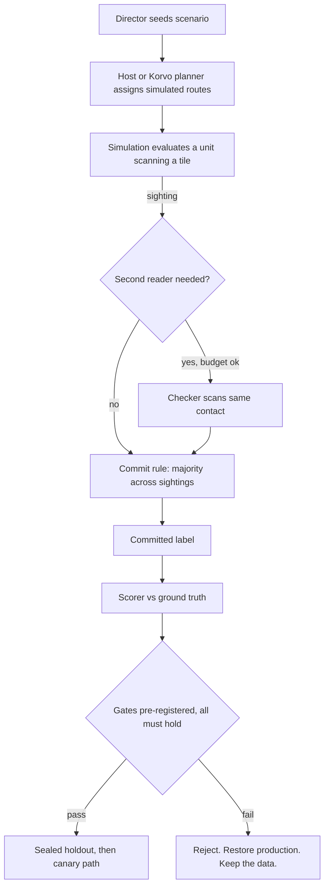

# Training-session results — methodology and reproducibility

This directory is the public lab book for Flockinator's
planner evaluation loop. It records simulated searches, candidate decision
policies, promotion decisions and separately labelled hardware field observations.
This page holds the result narrative and limitations. `results-data.json` holds the
published aggregates, and the dashboard is generated from that file.

- **Dashboard:** [`index.html`](index.html) — charts for every number
  below, generated by [`generate_dashboard.py`](generate_dashboard.py)
  from [`results-data.json`](results-data.json) (frozen, lane-reviewed aggregate reports for cycles 00-06; the bundled sample journals below reproduce the scorer fixtures, not every aggregate). Cycle-07 peer-report trust results (full journals, scores, verdicts): [`cycle-07/`](cycle-07/README.md). Also served via
  [the published results dashboard](https://guruswami-ai.github.io/flockinator-public/results/).
- **Scorer:** [`tools/fleet-score/`](../../tools/fleet-score/) —
  deterministic, stdlib-only Python. Scores one run directory of
  per-unit journals plus director ground truth.
- **Sample data:** `sample-runs/` — simulation journals only, no device data:
  8-unit baseline samples (seeds 0, 10) and the 16-unit
  `cycle-00-planner-capture` regression fixture.

## The experiment, on one page

These historical runs retain their original Friendly / Enemy / Neutral labels
for provenance. The current public scenario uses a rescue narrative. Historical
classification scores describe the original simulated task.

A *scenario* seeds hidden contacts by priority and cover on a tile board.
Sixteen simulated units follow search routes,
scan tiles, and report sightings. A sighting's label is drawn at the
scenario's identification accuracy (60–82% by cover; the focus row uses open-cover odds), so
single sightings are weak evidence. Units can be assigned as
independent *checkers* of a contact someone else found, subject to an
energy and return-home reserve budget. A label only becomes
*committed* — commander-actionable — under the candidate's commit
rule (e.g. strict majority across ≥3 sightings).



## Balanced scorecard and gates

Every candidate is scored on the same axes, paired per seed against
the frozen baseline: sighted recall, committed-label counts and
errors (with **Enemy→Friendly** tracked separately — that is the
dangerous direction), total energy, and landings/reserve violations.

Promotion gates are written down and committed **before** a candidate
is implemented, and are not edited after results are seen:
(Tooling note: the shipped `compare.py` implements the original
5-gate I2 comparison; later cycles were evaluated against their
own pre-registrations by per-cycle scripts in the private cycle
reports, over the identical eligible-seed set.)

1. Sighted recall ≥ baseline + 0.30 (dev).
2. ≥ 12 of 16 eligible seeds no worse than baseline.
3. Committed-label yield at or above the pre-registered floor.
4. Committed Enemy→Friendly = **0**.
5. Pooled committed mislabel rate ≤ baseline's.
6. Mean energy within the pre-registered ceiling.
7. Every unit lands home; zero reserve-floor violations.

Threshold provenance: the numeric floors derive from the frozen
baseline's own dev scores (recall floor 0.5141 = frozen baseline
0.2141 + 0.30; mislabel-rate cap = frozen baseline's rate; energy
ceiling per cycle) and are recorded in
[`results-data.json`](results-data.json) (`gates`). They were frozen
with each cycle's pre-registration before that candidate ran and
were not edited after results were seen.

Dev seeds are 0–19; seeds with no findable contacts under the frozen
baseline-energy rule are ineligible (16 of 20 eligible here).
Holdout seeds 100–109 are sealed: they run once, only if dev passes.
A failing candidate is preserved as a patch plus scores, production
is restored and re-verified (twin parity, frozen-score identity,
test suites), and the holdout stays sealed.

Two anti-cheating rules matter. Identification *rolls* recorded in
the decision telemetry must never feed commit decisions: in this
simulator the roll determines correctness, so margin-based commit
would be oracle leakage, not sensing. And planner replay is always
described as simulation evidence — never as on-node inference.

## What the four generations taught us

| Candidate | Sighted recall | Committed | Enemy→Friendly | Verdict |
|---|---:|---:|---:|---|
| search-board-1 (production) | 0.2141 | 17 | 0 | baseline (frozen) |
| Sector partition v1 | 0.6226 | 14 | 0 | rejected (frozen; sighted E→F rate rose) |
| + confirmation v2 | 0.6145 | 57 | 2 | rejected (frozen; gate 4) |
| + adaptive re-check v3 | 0.5971 | 51 | 2 | rejected (frozen; gates 4–5) |
| Asymmetric commit v4 | 0.5971 | 40 | 1 | rejected (frozen; gates 4–5) |

All four tested candidates failed the full promotion criteria on these runs.
Coverage improved, while a contact beside HOME produced repeated incorrect
observations across candidates. Asymmetric commit v4 reduced the recorded
Enemy→Friendly commits from two to one and still failed the required zero-error
gate. This supports rejection of the tested candidates under the recorded
conditions. Generalising to every possible decision policy would require further
experiments. Proposed next experiments are graded sensing and explicit abstention
for contested contacts.

## Reproduce

```sh
uv run --project tools/fleet-score python tools/fleet-score/score.py docs/results/sample-runs/baseline-seed-10
uv run --project tools/fleet-score python tools/fleet-score/score.py docs/results/sample-runs/cycle-00-planner-capture
uv run --project tools/fleet-score python -m pytest tools/fleet-score -q   # 19 tests
uv run --project tools/fleet-score python docs/results/generate_dashboard.py                          # rebuild charts
uv run --project tools/fleet-score python tools/fleet-score/baseline.py --seeds 0-19 --out /tmp/bl --label dev   # frozen baseline: recall 0.2141
```

The last command regenerates the frozen baseline over dev seeds
0-19 from the shipped planner twin; its mean eligible sighted
recall reproduces the frozen 0.2141 above. Candidate rows are
frozen aggregates: candidate journals are not bundled in this
repository, so candidate numbers are reported, not re-runnable
here.

To run your own candidate: generate journals with the mission host
(`tools/mission-host/`), score baseline and candidate on identical
seeds, and compare with `tools/fleet-score/compare.py`. Write your
pre-registration first — gates, eligible-seed rule, energy ceiling,
holdout discipline — then try to beat **recall ≥ 0.5141 with
Enemy→Friendly = 0**.

## Hardware side of the same loop

The Korvo exposes fleet state and a health API with a connectivity watchdog.
Its planner generates simulation journals and copies them to panel SD cards with
hash-verified readback. Successful delivery establishes an additional stored copy.
Ongoing journal generation and delivery depend on controller execution and
connectivity. Evidence of stored copies supports recovery of those archives after
an outage. Continuous capture of every panel decision requires separate evidence.

Firmware binaries are built on a host and deployed through the controlled canary
process. The [architecture](../architecture.md) identifies execution and storage
locations, and the [Muse pipeline](../meta-muse/README.md) describes review and
release responsibilities.

## Field findings from the live fleet (2026-11-05)

*Frozen field reports: serial/health-counter evidence from the
live fleet, recorded as observed; unlike the scorecard above,
these numbers are not scorer-reproducible from bundled journals.*

The same gated loop runs on hardware. Indicative results from the
first instrumented day (single lab network, one controller, 16
panels; treat as field observations, not controlled trials):

- **Controller wedge, classified.** The Korvo repeatedly entered an
  "associated-but-deaf" state: application, IP, and Wi-Fi
  association all healthy by every local signal, data path
  blackholed in both directions, and — decisively — *no disconnect
  event ever fired*, so the firmware's working reconnect path never
  triggered. Serial telemetry (68k+ lines) excluded heap, brownout,
  panic, and application hang. Panels continued their local scripted animation;
  no node reboot was reported.
- **Self-recovery as a designed experiment — now exercised.**
  Firmware 0.9.1 added a connectivity watchdog with pre-declared
  thresholds (5 min of global fleet-sweep silence -> forced
  reconnect -> logged restart, hourly backoff) and a health API
  exposing the counters. The wedge has since recurred twelve
  times on this build (counted from the controller serial log —
  one `Watchdog: ... Wi-Fi reconnect (sweep_age_s=...)` line per
  episode — cross-checked against the `/api/health` disconnect
  counter on 2026-11-05; two further ~1 min self-clearing
  transients with no disconnect or watchdog fire are not counted
  as episodes). Eleven episodes cleared identically: watchdog
  fired at ~303-329 s of sweep silence, forced a reconnect,
  service returned in ~2 s, no restart, continuous uptime —
  ~5.5 min bounded outages where the same fault previously ran
  unbounded for hours. One is the instructive failure:
  the reconnect associated and regained an IP, yet the data path
  stayed deaf, and an operator reboot ended the episode — the
  restart tier is still unexercised. The leading explanation is
  a design gap we can now name: a single successful panel poll
  counts as recovery and clears escalation, so partial deafness
  (inbound dead, rare outbound successes) can loop the reconnect
  tier indefinitely. Healthy windows vary widely (~15-123 min
  observed, not monotonic) and recurrences happen on the strong
  radio too, so association quality is at most a contributing
  factor. The *trigger* remains open (router-side lease/AP
  evidence pending); outage cost is capped in the common case
  and every event is timestamped in health counters.
- **Multiple radios, one SSID.** Association logs show the lab SSID
  served by two mesh/repeater radios on different 2.4 GHz channels
  at very different strengths (about -69 dBm vs -34 dBm at this
  controller). With no BSSID or scan policy configured, the ESP-IDF
  defaults associated to the weak radio on some boots; the two
  fastest post-recovery wedges followed weak-radio associations,
  while the longest healthy window runs on the strong one.
  Correlation is partial (one strong-radio boot also wedged
  quickly), so BSSID pinning is queued as a measured A/B candidate,
  not asserted as the cause. Provisioned, never hard-coded: this
  firmware carries no SSID, password, IP, or BSSID literals
  (verified in the shipped binary); credentials and roster live in
  device NVS, addressing is DHCP.
- **Observability is the experiment's substrate.** Panel health
  LEDs encode sweep-observation age, which made intermittent
  controller<->node polling gaps visible in the room before any
  log was opened. Field notes report continued panel animations during controller
  outages and retained journal copies. The public tree contains aggregate field
  observations. Establishing lossless event capture throughout an outage requires
  a complete event-sequence comparison across the controller and node records.
- **A second, distinct hiccup class** (single task-watchdog stall
  in a BSP timer/ADC path, spontaneous recovery, outside the new
  watchdog code) is recorded as an open watch item, not merged
  into the wedge story.

## Next experiment families

- **Graded sensing** — let units earn identification accuracy by
  spending energy (dwell/range), changing the evidence the commit
  rules vote on. Needs a scenario/sensor pre-registration.
- **Peer-report trust** — sighting reports can be wrong, buggy, or
  forged. The commissioning path already binds identity strongly
  (ESP-NOW frames carry sender/target MACs plus a full
  HMAC-SHA256 tag; receivers require header sender == layer-2
  source). Planned, staged work: forensic journaling of
  rejected/unknown frames; per-mission derived keys with pairwise
  verification material and short tags sized for intermittent
  low-bandwidth links (no tunnels); then pre-registered trust
  policies (ignore / discount / reputation-weight / abstain)
  against outsider-forgery, insider-error, and insider-liar
  treatments, scored like every other candidate. Design review
  by four independent model lanes hardened this plan before any
  code: symmetric verification keys are signing keys, so
  attribution is direct-only (relayed copies are hearsay); key
  rotation does not exist in-band today and is carried as an
  explicit residual risk; insider error outranks forgery as the
  expected harm. The scorer now segregates unverifiable reports
  before they can touch a vote (fail-closed for journals that
  carry auth fields; unauthenticated legacy journals are trusted
  by definition and must not be mixed into a trust-policy run —
  independently
  probed), with the trust-policy cycle pre-registered and its
  instrument fixes gated on adversarial re-review. Authentication
  proves who spoke; corroboration decides what to believe — the
  two layers are measured separately on purpose.
- **Lone-node policy** — proceed-and-log vs return-on-link-loss vs
  move-toward-last-peer, under induced dropouts, once per-node
  link-state journaling shares the flight-telemetry timeline
  (which first needs the controller-as-time-authority clock).

## Why tiered AI experimenters

This program is run by a tiered model fleet — a supervisor model,
a coordinator, and sixteen per-node worker lanes in four model
tiers (see `docs/meta-muse/`) — acting as experimental designer,
implementer, independent reviewer, and scorer under human-set
gates. The pattern that makes it trustworthy is not autonomy
itself but the discipline around it: hypotheses pre-registered
before code, numbers reproduced by a lane that did not produce
them, holdouts sealed against the designers, and rejections
published with the same care as wins. Whether this is *more
efficient* than human-only design for non-deterministic,
highly-coupled systems — and where the efficiency actually lives
(search breadth, iteration speed, review independence, tireless
bookkeeping) — is itself an open research question this framework
is built to make measurable.

## Residual problems (open at competition freeze, 2026-11-05)

| # | Problem | Evidence / status | Next step |
|---|---|---|---|
| R1 | Controller Wi-Fi wedge trigger unknown | Associated-but-deaf state recurs; watchdog bounds most outages to ~5.5 min (11 reconnect recoveries of 12 episodes; 1 needed manual reboot; counted from serial-log watchdog lines cross-checked with /api/health counters, 2026-11-05); heap/brownout/panic excluded by serial telemetry | Router-side lease duration + AP client log; BSSID-pin and modem-sleep-off A/B candidates |
| R2 | Healthy windows vary widely (~15-123 min observed) | Reassociation does not clear the accumulating state | Same evidence as R1; consider restart-tier observation if a reconnect ever fails |
| R3 | One-off task-watchdog stall in BSP timer/ADC path | Single 09:28 event, spontaneous recovery, outside watchdog code | BSP timer-callback audit; watch for recurrence in health counters |
| R4 | Node execution telemetry is sampled, not archived | Planner journals are durable (controller SD + node SD copies); per-node link-state/RSSI history is not yet persisted with flight data | Store-and-forward stage in the durability design; rejected-frame forensic journal (trust stage 0) |
| R5 | Fleet clock authority incomplete | Controller SNTP configured but not started; mission code has "clock pending" paths; cross-device timestamps need the controller-as-time-source design (ESP-NOW clock beacons) | Enable controller time service, then node clock discipline |
| R6 | No in-band key rotation | Node maintenance accepts only the identical provisioned key; capture recovery is physical re-provisioning | Key-epoch design before any relayed mesh (see trust families) |
| R7 | Judgement ceiling at current sensing | Four tested candidates failed the full promotion criteria at the recorded sensing accuracy | Graded sensing pre-registration (accuracy earned by energy spend) |
| R8 | Trust policies unmeasured | Scorer segregates unverifiable reports; adversarial-review fixes are frozen in an amendment, treatments not yet run | Fix round + re-review, then cycle-07 stage-1 runs |
| R9 | Watchdog escalation can be cleared by partial success | One authenticated panel poll counts as recovery and resets escalation, so partial deafness (inbound dead, rare outbound successes) may loop reconnects without reaching the restart tier; restart tier still unexercised | Sustained-recovery clear (>=k distinct panels or consecutive ticks), reconnect-count escalation, inbound-served proxy — as a pre-registered candidate |

The drone survey is the current scenario, not the point. The same
loop — seeded scenarios, director truth held apart from agent
inputs, attributable telemetry, gated firmware evolution — applies
to any fleet of small interacting devices: traffic cameras
corroborating an incident, medical sensors cross-checking a
reading, infrastructure monitors voting on a fault. Self-improving
multi-node agents will be judged by whether their improvement
claims survive exactly this kind of hostile bookkeeping.
