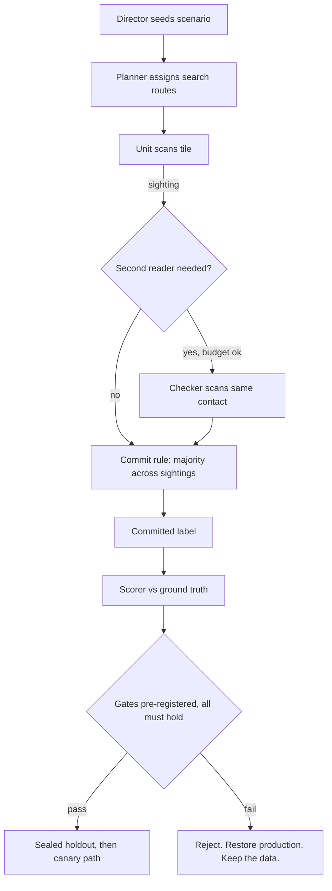

# Training-session results — methodology and reproducibility

This directory is the public lab book for Flockinator's
planner-intelligence loop: how sixteen ESP32 survey panels learn to
search seeded scenarios, judge what they see, and (critically) refuse
to ship intelligence that fails its own safety gates.

- **Dashboard:** [`index.html`](index.html) — charts for every number
  below, generated by [`generate_dashboard.py`](generate_dashboard.py)
  from [`results-data.json`](results-data.json). Also served via
  GitHub Pages under `docs/results/`.
- **Scorer:** [`tools/fleet-score/`](../../tools/fleet-score/) —
  deterministic, stdlib-only Python. Scores one run directory of
  per-unit journals plus director ground truth.
- **Sample data:** `sample-runs/` — simulation journals only, no
  device data. `cycle-00-live-capture` is the regression fixture the
  scorer test-suite reproduces headline counts from.

## The experiment, on one page

A *scenario* seeds hidden contacts (Friendly / Enemy / Neutral, by
priority and cover) on a tile board. Sixteen units fly search routes,
scan tiles, and report sightings. A sighting's label is drawn at the
scenario's identification accuracy (60–82% by priority/cover), so
single sightings are weak evidence. Units can be assigned as
independent *checkers* of a contact someone else found, subject to an
energy and return-home reserve budget. A label only becomes
*committed* — commander-actionable — under the candidate's commit
rule (e.g. strict majority across ≥3 sightings).



## Balanced scorecard and gates

Every candidate is scored on the same axes, paired per seed against
the frozen baseline: sighted recall, committed-label counts and
errors (with **Enemy→Friendly** tracked separately — that is the
dangerous direction), total energy, and landings/reserve violations.

Promotion gates are written down and committed **before** a candidate
is implemented, and are not edited after results are seen:

1. Sighted recall ≥ baseline + 0.30 (dev).
2. ≥ 12 of 16 eligible seeds no worse than baseline.
3. Committed-label yield at or above the pre-registered floor.
4. Committed Enemy→Friendly = **0**.
5. Pooled committed mislabel rate ≤ baseline's.
6. Mean energy within the pre-registered ceiling.
7. Every unit lands home; zero reserve-floor violations.

Dev seeds are 0–19; seeds with no findable contacts under the frozen
baseline-energy rule are ineligible (16 of 20 eligible here).
Holdout seeds 100–109 are sealed: they run once, only if dev passes.
A failing candidate is preserved as a patch plus scores, production
is restored and re-verified (twin parity, frozen-score identity,
test suites), and the holdout stays sealed.

Two anti-cheating rules matter. Identification *rolls* recorded in
the decision telemetry must never feed commit decisions: in this
simulator the roll determines correctness, so margin-based commit
would be oracle leakage, not sensing. And planner replay is always
described as simulation evidence — never as on-node inference.

## What the four generations taught us

| Candidate | Sighted recall | Committed | Enemy→Friendly | Verdict |
|---|---:|---:|---:|---|
| search-board-1 (production) | 0.2141 | 17 | 0 | baseline |
| Sector partition v1 | 0.6226 | 14 | 0 | rejected (sighted E→F rate rose) |
| + confirmation v2 | 0.6145 | 57 | 2 | rejected (gate 4) |
| + adaptive re-check v3 | 0.5971 | 51 | 2 | rejected (gates 4–5) |
| Asymmetric commit v4 | 0.5971 | 40 | 1 | rejected (gates 4–5) |

The boundary is statistical, not engineering: at fixed per-sighting
accuracy, raising commit yield raises the chance of a wrong majority,
and correlated sightings (one contact beside HOME drew repeated wrong
reads across candidates) defeat unanimity too. Coverage is solved;
judgement is the open problem. Asymmetric commit costs (v4) halved
the dangerous commits but a unanimous-wrong contact still defeated
them — the whole commit-rule family is now closed by measurement.
The next levers are graded sensing (accuracy a unit can earn by
spending energy) and explicit abstention for contested contacts.

## Reproduce

```sh
python3 tools/fleet-score/score.py docs/results/sample-runs/baseline-seed-10
python3 tools/fleet-score/score.py docs/results/sample-runs/cycle-00-live-capture
python3 -m unittest discover -s tools/fleet-score -p 'test_*.py'   # 10 tests
python3 docs/results/generate_dashboard.py                          # rebuild charts
```

To run your own candidate: generate journals with the mission host
(`tools/mission-host/`), score baseline and candidate on identical
seeds, and compare with `tools/fleet-score/compare.py`. Write your
pre-registration first — gates, eligible-seed rule, energy ceiling,
holdout discipline — then try to beat **recall ≥ 0.5141 with
Enemy→Friendly = 0**.

## Hardware side of the same loop

The scorecard was designed against live telemetry, not just replay:
the Korvo controller exposes fleet state and (from firmware 0.9.1) a
health API with a connectivity watchdog; panel nodes keep
hash-verified mission journals on their own SD cards so a controller
outage loses no flight data. Firmware binaries are built on a host,
staged on the controller's SD store, and deployed to nodes under a
canary discipline — host tests, replay, controller flash, fleet
canary, promotion gate. See `docs/design/` and `docs/meta-muse/`
for the build/deploy and multi-model review pipeline.

## Field findings from the live fleet (2026-11-05)

The same gated loop runs on hardware. Indicative results from the
first instrumented day (single lab network, one controller, 16
panels; treat as field observations, not controlled trials):

- **Controller wedge, classified.** The Korvo repeatedly entered an
  "associated-but-deaf" state: application, IP, and Wi-Fi
  association all healthy by every local signal, data path
  blackholed in both directions, and — decisively — *no disconnect
  event ever fired*, so the firmware's working reconnect path never
  triggered. Serial telemetry (68k+ lines) excluded heap, brownout,
  panic, and application hang. Panels flew autonomously throughout;
  no node rebooted.
- **Self-recovery as a designed experiment.** Firmware 0.9.1 added
  a connectivity watchdog with pre-declared thresholds (5 min of
  global fleet-sweep silence -> forced reconnect -> logged restart,
  hourly backoff) and a health API exposing the counters. Post-flash
  soak (this build): one sub-minute deaf interval that self-cleared
  below threshold, sporadic single poll timeouts thereafter, sweep
  continuously fresh, zero watchdog restarts needed so far. The
  wedge *trigger* remains open; the watchdog converts an unbounded
  outage into a bounded, logged one while diagnosis continues.
- **Multiple radios, one SSID.** Association logs show the lab SSID
  served by two mesh/repeater radios on different 2.4 GHz channels
  at very different strengths (about -69 dBm vs -34 dBm at this
  controller). With no BSSID or scan policy configured, the ESP-IDF
  defaults associated to the weak radio on some boots; the two
  fastest post-recovery wedges followed weak-radio associations,
  while the longest healthy window runs on the strong one.
  Correlation is partial (one strong-radio boot also wedged
  quickly), so BSSID pinning is queued as a measured A/B candidate,
  not asserted as the cause. Provisioned, never hard-coded: this
  firmware carries no SSID, password, IP, or BSSID literals
  (verified in the shipped binary); credentials and roster live in
  device NVS, addressing is DHCP.
- **Observability is the experiment's substrate.** Panel health
  LEDs encode sweep-observation age, which made intermittent
  controller<->node polling gaps visible in the room before any
  log was opened. The node fleet's answer to controller loss —
  continue the mission, journal to local SD, reconcile later —
  was exercised for real, repeatedly, without data loss.
- **A second, distinct hiccup class** (single task-watchdog stall
  in a BSP timer/ADC path, spontaneous recovery, outside the new
  watchdog code) is recorded as an open watch item, not merged
  into the wedge story.

## Next experiment families

- **Graded sensing** — let units earn identification accuracy by
  spending energy (dwell/range), changing the evidence the commit
  rules vote on. Needs a scenario/sensor pre-registration.
- **Peer-report trust** — sighting reports can be wrong, buggy, or
  forged. The commissioning path already binds identity strongly
  (ESP-NOW frames carry sender/target MACs plus a full
  HMAC-SHA256 tag; receivers require header sender == layer-2
  source). Planned, staged work: forensic journaling of
  rejected/unknown frames; per-mission derived keys with pairwise
  verification material and short tags sized for intermittent
  low-bandwidth links (no tunnels); then pre-registered trust
  policies (ignore / discount / reputation-weight / abstain)
  against outsider-forgery, insider-error, and insider-liar
  treatments, scored like every other candidate. Authentication
  proves who spoke; corroboration decides what to believe — the
  two layers are measured separately on purpose.
- **Lone-node policy** — proceed-and-log vs return-on-link-loss vs
  move-toward-last-peer, under induced dropouts, once per-node
  link-state journaling shares the flight-telemetry timeline
  (which first needs the controller-as-time-authority clock).

## Why tiered AI experimenters

This program is run by a tiered model fleet — a supervisor model,
a coordinator, and sixteen per-node worker lanes in four model
tiers (see `docs/meta-muse/`) — acting as experimental designer,
implementer, independent reviewer, and scorer under human-set
gates. The pattern that makes it trustworthy is not autonomy
itself but the discipline around it: hypotheses pre-registered
before code, numbers reproduced by a lane that did not produce
them, holdouts sealed against the designers, and rejections
published with the same care as wins. Whether this is *more
efficient* than human-only design for non-deterministic,
highly-coupled systems — and where the efficiency actually lives
(search breadth, iteration speed, review independence, tireless
bookkeeping) — is itself an open research question this framework
is built to make measurable.

The drone survey is the current scenario, not the point. The same
loop — seeded scenarios, director truth held apart from agent
inputs, attributable telemetry, gated firmware evolution — applies
to any fleet of small interacting devices: traffic cameras
corroborating an incident, medical sensors cross-checking a
reading, infrastructure monitors voting on a fault. Self-improving
multi-node agents will be judged by whether their improvement
claims survive exactly this kind of hostile bookkeeping.
